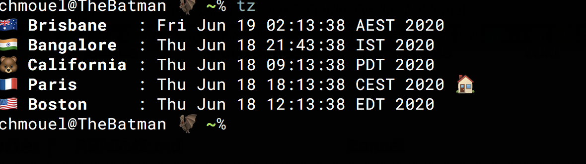
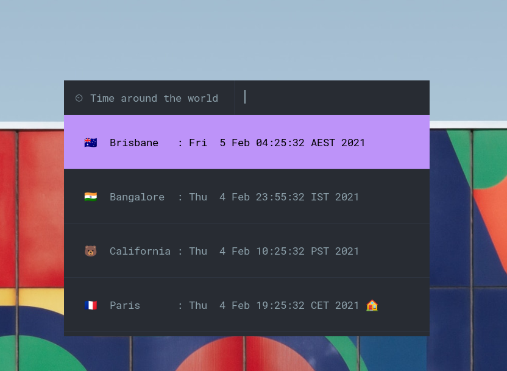
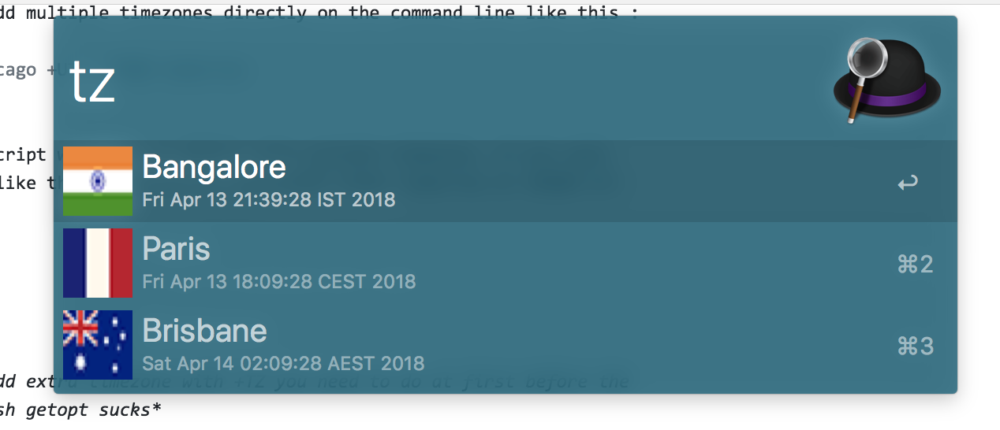

# batzconverter - Batman Timezone Converter

Show times in different timezones. The original `batz.sh` and the Go port
`batz-go` are distributed in parallel while output compatibility is validated.

## Blog post

<https://blog.chmouel.com/2021/01/31/batzconverter-a-multiple-timezone-converter/>

## Demo



## INSTALL

### Go port

The Go port removes the Bash 4 dependency, but deliberately delegates
natural-language parsing and formatting to GNU `date` to preserve expressions
such as `10h00 tomorrow` and existing `strftime` formats exactly.

```bash
go install github.com/chmouel/batzconverter/cmd/batz-go@latest
batz-go 10h00 tomorrow
```

Tagged releases also contain `batz-go` archives for Linux and macOS. Keep using
`batz.sh` as `batz` while evaluating the Go port; the two commands can coexist.

### Bash script

grab the shell script directly from this repo and put it in your path, or just copy and paste this :

```bash
#  will try to install in /usr/local if you have the right or $HOME/.local/bin need to be in your path
dest="/usr/local/bin"
[[ -w ${dest} ]] || { dest=${HOME}/.local/bin;mkdir -p ${dest} ;}
curl -f -L -o ${dest}/batz https://raw.githubusercontent.com/chmouel/batzconverter/master/batz.sh && \
        chmod +x ${dest}/batz && \
 echo "'The' batz has been installed into: ${dest}/batz"
```

## Settings

### Go configuration

`batz-go` reads `~/.config/batz/config.toml`, or the file named by
`BATZ_CONFIG_FILE`. Start with [`config.example.toml`](./config.example.toml).
Timezone entries are an ordered array, so output follows configuration order.
When `emoji` is omitted, `batz-go` derives the country's flag from the system
IANA timezone database. Explicit values remain overrides, so custom symbols
such as California's bear are preserved. UTC and `Etc/*` zones use 🌍.

```toml
date_format = "%b %Hh%M"
default_timezone_emoji = "🌐 "
screenshot_theme = "light"

[[timezone]]
name = "India"
zone = "Asia/Calcutta"
emoji = "🇮🇳 "

[[timezone]]
name = "Europe"
zone = "Europe/Paris"
emoji = "🇪🇺 "
icon = "/path/to/icons/Europe.png"
```

Migration from the Bash configuration is direct: each matching
`TIME_ZONES`, `TIME_ZONES_EMOJI`, and `TIME_ZONES_ICONS` key becomes one
`[[timezone]]` entry. Invalid TOML, duplicate names, and invalid IANA zones are
reported instead of being ignored.

The Go port sizes columns automatically. Remove the obsolete
`date_format_padding` and `use_gum` keys from older TOML files; strict loading
reports either key as unknown.

### Bash configuration

Create a file in `~/.config/batz/config` and add configure the `TIME_ZONES` and
`TIME_ZONES_EMOJI` variable like this :

```shell
## Change the default timezones here!
TIME_ZONES=(
  ["India"]="Asia/Calcutta"
  ["Europe"]="Europe/Paris"
  ["US-East"]="America/New_York"
  ["US-West"]="America/Los_Angeles"
)

TIME_ZONES_EMOJI=(
 ["India"]="🇮🇳 "
 ["Europe"]="🇪🇺 "
 ["US-East"]="🇺🇸 "
 ["US-West"]="🐻"
)

TIME_ZONES_ICONS=(
 ["India"]="/path/to/icons/India.png"
 ["Europe"]="/path/to/icons/Europe.png"
 ["US-East"]="/path/to/icons/US-East.png"
 ["US-West"]="/path/to/icons/US-West.png"
)

DATE_FORMAT="%b %Hh%M"
DATE_FORMAT_PADDING=10
DEFAULT_TIME_ZOME_EMOJI="🌐"
```

The format is :

    "TZ_Alias_Name"="Timezone"

for example :

    "HomeSweetHome"="Europe/Paris"

You can look an example in my config [here](https://gitlab.com/chmouel/rc-config/-/blob/main/batz/config)

you can redefine the location of the config file with the `BATZ_CONFIG_FILE` environment variable.

## Requirement

Both implementations require modern GNU `date`. On macOS install coreutils with
`brew install coreutils`; `batz-go` automatically prefers `gdate`. The Bash
implementation additionally needs Bash 4 or newer.

Optional features retain their existing tools: `fzf` and `zdump` for `-f`, and
the renderer/clipboard dependencies described below for `-s`.

### Bash and Go compatibility

Both implementations delegate date parsing and formatting to GNU `date`, so
expressions and timezone conversion semantics are shared. The Go command keeps
several deliberate improvements:

| Area | `batz.sh` | `batz-go` |
|---|---|---|
| Configuration | Executable Bash variables | Strict ordered TOML |
| Ordering | Associative-array order | Declared TOML order |
| Emoji | Explicit map or globe fallback | Explicit override or inferred IANA country flag |
| Terminal | Manual byte padding; optional gum | Unicode-aware rounded table; borderless when piped |
| JSON | Constructed by shell | Escaped with Go's JSON encoder |
| Colors | May force ANSI into pipes | Pipes remain ANSI-free |
| `-n` / `-E` | Marker behavior is coupled to color | `-n` controls style; `-E` removes emoji and markers |
| Gum/padding | `-g`, `USE_GUM`, `DATE_FORMAT_PADDING` | Intentionally removed |
| Validation | Mostly deferred to tools | Strict config, IANA zone, and option validation |
| Errors | Shell/tool failures | Contextual typed errors |

The Go version accepts clustered and attached short options more predictably
and validates that interactive selections came from the system timezone
catalog. It does not evaluate legacy shell configuration.

## Usage

```bash
% batz
% batz 10h30
% batz 10h30 next week
% batz 11:00 next thursday
```

BaTZ  will show all different timezone for the timeformat

You can as well add multiple timezones directly on the command line like this :

```bash
% batz +America/Chicago +UTC 10h00 tomorrow
```

If you don't know the timezone and you have the
[fzf](https://github.com/junegunn/fzf) utility installed you can use the `-f`
option to select interactively the timezone. You can select multiple timezone
by using the `TAB` key in fzf.

By default this script will try to detect your current timezone, if you want
to say something like this:
show me the different times tomorrow if I were at 10h00 AM on UTC timezone, you can do :

```bash
% batz -t UTC 10h00
````

When you set another timezone than your current one, it wil show a nice ✈️emoji
near your different base timezone, or by default it will show a 🏠 emojis to
emphasis the current timezone in your copy and paste.

*If you want to add extra timezone with +TZ you need to do at first before the
options, cause bash getopt is kind of buggy in this regard*

You can use the `-j` option to output as json and may do some parsing with it
(this is used by the Alfred support).

`batz-go` renders a rounded, Unicode-aware table on terminals, keeping flags
and custom emoji aligned. Redirected and piped output is borderless and
ANSI-free while retaining aligned columns.

The Bash implementation retains its optional
[gum](https://github.com/charmbracelet/gum) `-g` mode and `USE_GUM` setting;
these are intentionally not part of `batz-go`.

The output looks for example like this for me:


Use `-s` to render a polished world clock card and copy it to the clipboard:

```bash
batz -s 10h30 tomorrow
```

Screenshot output uses the native renderer and pasteboard on macOS. On Linux,
only Wayland sessions are supported (X11 is not): it uses `rsvg-convert` or
ImageMagick to render the PNG and `wl-copy` to copy it, so install
`wl-clipboard` in addition to one of the renderers.

The card comes in a light (default) and a dark theme. Pick one with `-S`:

```bash
batz -s -S dark
```

or set `BATZ_SCREENSHOT_THEME=dark` in your config file to make it the
default.

On macOS the card shows emoji flags. On Linux it shows the country code of
each timezone instead (like FR or US), since emojis don't come out looking
right there.


**Example of a screenshot**

Use `-n` to disable colors and `-E` to disable emoji and local/base markers.
`batz-go` also respects the [`NO_COLOR`](https://no-color.org/) environment
variable.

## [Rofi](https://github.com/davatorium/rofi) Support

Take this rofi script [rofibatz.sh](./share/rofibatz.sh) and place it somewhere, i.e: `~/.config/rofi/rofibatz.sh`, launch it up like this :

`rofi -modi batz:${HOME}/.config/rofi/rofibatz.sh -show batz`

You can type batz string i.e: `13h00 tomorrow` when you press enter it will evaluate it.

I have a [custom theme](https://github.com/chmouel/mounch/blob/main/rofi/mounch.rasi) so your mileage may vary but for me it will be shown like this :



## [Wofi](https://hg.sr.ht/~scoopta/wofi) Support


Just do something like this assuming you have wofi and wl-copy installed :

```shell
wl-copy $(batz|sed -e "s/\x1b\[.\{1,5\}m//g"|wofi -d|sed 's/.* : //')
```

will only get you the timezone since wofi doesnt support scripts (afaik)

## [Alfred](https://www.alfredapp.com/) Support

Batz support [alfred](https://www.alfredapp.com/), it basically output nicely the timezone from alfred in a nice way.



Just install the [alfredworlflow file](./alfredworkflow/TZ.alfredworkflow) from the repository
and make sure the batz script is in one of these path: `$HOME/bin/` or `/usr/local/bin/`

To include icons in the Alfred JSON output, configure the `TIME_ZONES_ICONS`
hashmap in your config file (`~/.config/batz/config`):

```bash
TIME_ZONES_ICONS=(
  ["Paris"]="/path/to/icons/Paris.png"
  ["Boston"]="/path/to/icons/Boston.png"
  ["California"]="/path/to/icons/California.png"
)
```

Each timezone that has an entry in `TIME_ZONES_ICONS` will display its
corresponding icon in Alfred. Timezones without an icon entry will be displayed
without an icon.

## Using raffi on Linux

raffi supports as well the json output of batz, you can do something like this to trigger it:

```shell

addons:
  script_filters:
    - name: "Timezone"
      command: "batz.sh"
      args: ["-j"]
      keyword: "tz"
```

## [Zenity](https://help.gnome.org/users/zenity/stable/) support

```shell
output=$(zenity --entry --text "🦇Time" --entry-text $(date ''+%H:%M''));[[ -n $output ]] && batz $output|wl-copy',
```

## Copyright

[Apache-2.0](./LICENSE)

## Authors

Chmouel Boudjnah <[@chmouel](https://twitter.com/chmouel)>
